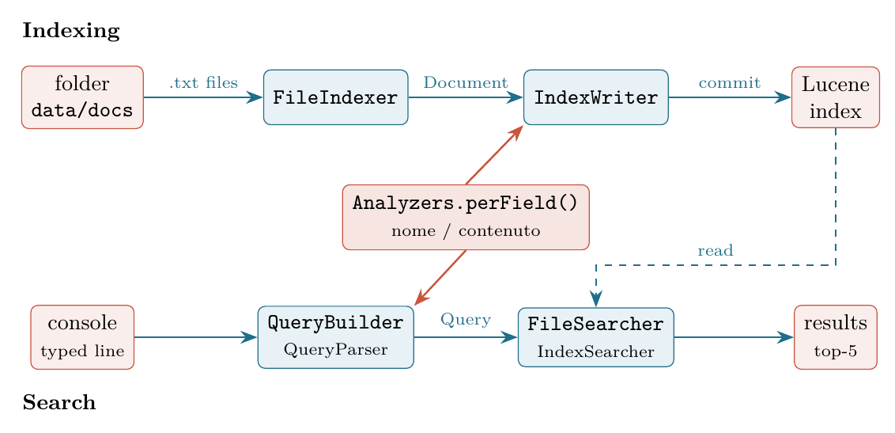

# lucene-file-indexer

Homework for the Data Engineering course: index the `.txt` files of a directory with
Apache Lucene on two fields (file name and file content, each with its own analyzer) and
query them from the console.

Report: see the PDF delivered with the homework. Repository:
<https://github.com/adducec03/lucene-file-indexer>

## Requirements
- Java 21
- Maven: nothing to install, the included `./mvnw` wrapper downloads it
- Python 3 (only for the scripts in `tools/`, standard library only)

## Quick start
```bash
./index.sh                 # indexes data/docs into index/
./search.sh                # interactive search (type exit to quit)
```
Without Bash, use Maven directly:
```bash
./mvnw compile
./mvnw exec:java -Dexec.args="index data/docs index"
./mvnw exec:java -Dexec.args="search index"
```
`index.sh [docsDir] [indexDir]` and `search.sh [indexDir]` wrap these commands
(paths with spaces are not supported).

## Query syntax
A query is `<field> <terms>`, where the field is `nome` (file name) or `contenuto` (content).
Terms without quotes are combined with OR; terms in quotes form a phrase.
```
nome knitting
contenuto guerra mondiale        # guerra OR mondiale
contenuto "world war"            # phrase query
```
Example session:
```
> contenuto "world war"
total number of results: 16
name: en_Protectorate_of_Bohemia_and_Moravia; score: ...; position: 1
...
> titolo knitting
Error: unknown field, use 'nome' or 'contenuto'
```
Only the top 5 results are printed, together with the total number of results.
The Lucene `QueryParser` also understands `+`, `-`, `~`, `*` and `field:term`.

## Project structure
```
src/main/java/it/homework/lucene/   the program (see below)
data/docs/                          small corpus (202 files) used for development and tests
data/corpus/                        large corpus (2810 files), generated by tools/build_corpus.py
data/corpus-manifest.csv            description of the large corpus (topic, length, categories)
queries.txt                         the 21 test queries
run-queries.sh                      runs queries.txt and writes results/query-results.md
results/                            outputs: query results, indexing benchmark, evaluation
tools/                              Python scripts for corpus, benchmark and evaluation checks
report/                             LaTeX report
```

The program has two flows, indexing and search. Both use the same analyzer per field
(in red), so the query terms are processed exactly like the indexed text.



| Class | Responsibility |
|---|---|
| `Main` | `index` and `search` commands, interactive loop |
| `Analyzers` | field names and per-field analyzers (`PerFieldAnalyzerWrapper`) |
| `FileIndexer` | walks the directory and creates one Lucene `Document` per file |
| `QueryBuilder` | turns the typed line into a Lucene `Query` |
| `FileSearcher` | opens the index, runs the query and prints the results |
| `Evaluator` | evaluation only: precision, recall and F1 against a lexical ground truth |

## Analyzers
- `nome`: `_` becomes a space, standard tokenizer, lowercase, accent folding.
- `contenuto`: standard tokenizer, Italian elision removal (`dell'uomo` -> `uomo`), English
  possessive removal (`dog's` -> `dog`), lowercase, accent folding.
- No stopwords and no stemming: the text is bilingual (Italian and English) and the stopword
  lists of the two languages collide (`era`, `dove`, `all` are common words in both).
- A first version (`StandardAnalyzer` + both stopword lists) lost many files (recall 0.82 on
  average on the large corpus); the report explains the problems and the fix.

## Dataset
The texts are Wikipedia articles (Italian and English), released under CC BY-SA.
`data/docs` is included; the large corpus is not, but can be rebuilt:
```bash
python3 tools/build_corpus.py          # downloads data/corpus (resumable, honours rate limits)
```
It takes articles from 14 Wikipedia categories per language plus random articles as noise.

## Measurements
```bash
python3 tools/benchmark_indexing.py    # indexing time for 200/500/1000/2000/all files
./run-queries.sh                       # the 21 test queries
python3 tools/crosscheck_oracle.py     # checks the evaluation ground truth with perl and grep
```
The evaluation itself is the `Evaluator` class (the `pom.xml` fixes the main class, so run it
with `java`):
```bash
./mvnw -q dependency:build-classpath -Dmdep.outputFile=cp.txt
java -cp "target/classes:$(cat cp.txt)" it.homework.lucene.Evaluator data/corpus results/evaluation.md
```

## Results (large corpus, 2810 files, 34 MB of text)
- Indexing: about 2.3 s (median of 5 runs, new JVM each time), about 0.83 ms per file; the
  index is about 40% of the size of the text.
- Search quality against a lexical ground truth (26 queries): precision 1.00 and recall 1.00
  for the final analyzers, against 0.88 and 0.82 for the first version.
- Known losses: some Italian elisions missing from the article list (`quest'uomo`, `com'era`)
  and web addresses inside the text (`volcano.und`). Details in the report.
